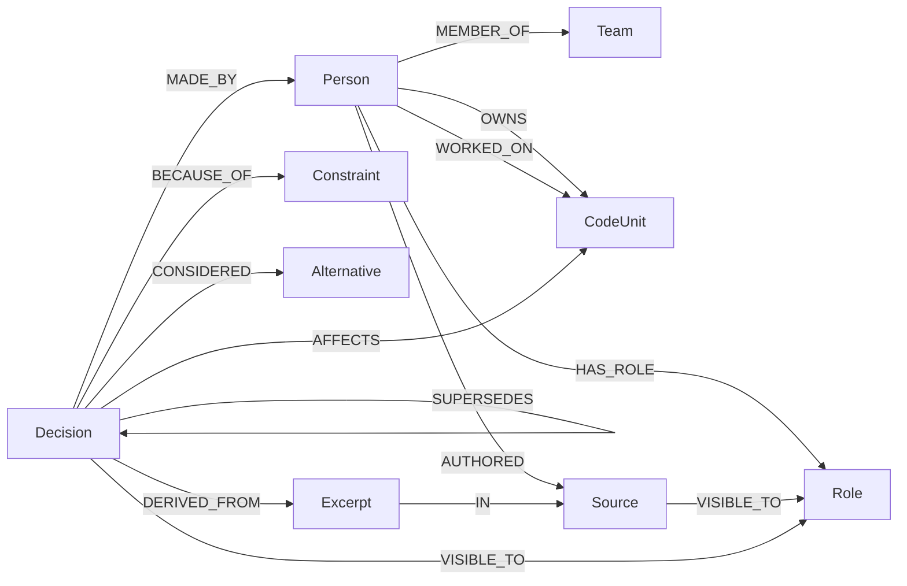
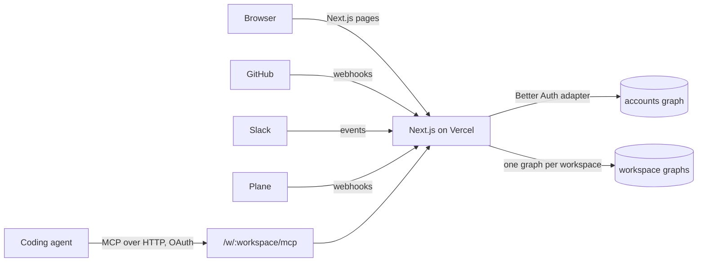

# Axon

Axon is a company brain for small teams, built on [FalkorDB](https://www.falkordb.com/) for [Graph Hacks: Context for AI Agents](https://www.wemakedevs.org/hackathons/falkordb). It reads the PRs, tickets, chats and coding sessions where a team makes decisions, keeps each decision linked to who made it, why, what it affects and the exact quote it came from, and gives that context to people and to their coding agents.

Early teams decide things in a PR comment or a Slack thread and rarely write them down. The next person, or the next AI agent working on the code, never sees that decision, so it gets undone and old edge cases come back.

- Live site: https://axonteam.vercel.app
- Demo video: TODO
- Track: Track 03, Company Brain

## Track 03 focus points

| Focus point | Where it lives in Axon | Query or tool |
| --- | --- | --- |
| Knowledge from docs, tickets and chats in one graph | GitHub, Plane and Slack connectors write PRs, reviews, commits, docs, work items and messages into the workspace graph through one shared writer. Coding sessions are saved with `save_session`. | `lib/connectors/write.ts`, [Plane and Slack](docs/ontology.md#plane-and-slack), [GitHub](docs/ontology.md#github), [Session capture](docs/ontology.md#session-capture) |
| Who owns what and who knows what | People page (`/w/<workspace>/people`) and the `who_knows` MCP tool share one scoring query over `OWNS`, `MADE_BY`, `APPROVED_BY`, `AUTHORED` and `WORKED_ON`. CODEOWNERS becomes `OWNS` edges. | `rankPeople` in `lib/brain/people.ts`, [Who knows](docs/ontology.md#who-knows) |
| Tracing decisions to their source | Every decision is `DERIVED_FROM` a verbatim `Excerpt` `IN` a `Source`. `recall` prints the source quote, its link and a graph path computed by `shortestPath`. | `lib/brain/tools/recall.ts`, [Recall](docs/ontology.md#recall) |
| Keeping knowledge current | Webhooks keep sources in sync. When a source behind an accepted decision is edited or deleted, the decision is flagged until someone confirms it still holds or supersedes it. `supersede` keeps the old decision as history. `impact` lists what depended on a constraint that stopped being true. | `lib/brain/source-changes.ts`, [Source changes](docs/ontology.md#source-changes), [Impact](docs/ontology.md#impact) |
| Answers with clear sources | `recall` returns the decision and status, its reasons, rejected alternatives, who decided and when, the source quote and link, and the path. Restricted matches come back only as "ask <Admin>". | `lib/brain/tools/recall.ts` |

<!-- TODO after session A merges: PageRank in who_knows, changes_since, check_answer, conflict hints. -->
<!-- TODO after session B merges: cross-source REFERENCES links. -->
<!-- TODO after session F merges: saved answers that go stale. -->

## Why FalkorDB does real work

FalkorDB is the only data store. Without it Axon has no accounts, workspaces, decisions or access control.

- One graph per workspace. Each company gets its own graph (`<prefix>_<slug>`), and the slug is the same one in its MCP address `/w/<slug>/mcp`. Accounts, sessions and OAuth tokens live in a separate accounts graph.
- Read-only queries for agents. Every agent read goes through `GRAPH.RO_QUERY` (`roQuery` in `lib/graph/client.ts`). FalkorDB rejects any write sent that way, which PR #4 tested.
- Access control inside Cypher. Every read starts from the calling Person and their Role, and checks `VISIBLE_TO` with a pattern predicate in `WHERE`. The LLM only sees rows that passed the filter. Restricted matches are only counted.
- Full-text indexes on `Decision(title, statement)` and `Excerpt(text)` are where recall starts.
- `shortestPath` computes the path from a decision to its source and to its maker, after both ends pass the visibility filter.
- Constraint impact. Reasons are shared `Constraint` and `Assumption` nodes, so one traversal over `BECAUSE_OF` finds every decision that relied on one.
- Role changes in one query. Changing a role checks the Admin and keeps at least one Admin inside the same Cypher statement.

<!-- TODO after session A merges: algo.pageRank on access-filtered projections. -->

## Graph model

The full model is in [docs/ontology.md](docs/ontology.md). The core:



- `Source` has subtypes `PR`, `Commit`, `Doc`, `Message`, `WorkItem` and `Conversation`. A FalkorDB node can carry several labels, so a Plane ticket is `(:WorkItem:Source)`.
- Visibility is `public` (Admin, Member, Guest), `team` (Admin, Member) or `restricted` (Admin, or the Team or Person it names). A decision copies the visibility of the source it came from.
- Nothing is deleted. A new decision `SUPERSEDES` the old one, which keeps its history with `valid_to`.

### Key queries

These are copied from the code. `FROM_CALLER` and `visible(x)` come from `lib/brain/access.ts`:

```cypher
-- FROM_CALLER
MATCH (u:Person {id: $personId})-[:HAS_ROLE]->(role:Role)
-- visible(d)
((d)-[:VISIBLE_TO]->(u) OR (d)-[:VISIBLE_TO]->(role) OR (d)-[:VISIBLE_TO]->(:Team)<-[:MEMBER_OF]-(u))
```

**Recall entry point** (`lib/brain/tools/recall.ts`). Full-text search, then the visibility filter. Two more branches enter through excerpts and through linked topics or files:

```cypher
MATCH (u:Person {id: $personId})-[:HAS_ROLE]->(role:Role)
CALL db.idx.fulltext.queryNodes('Decision', $q) YIELD node AS d, score
WITH u, role, d, score
WHERE d.status <> 'dismissed' AND <visible(d)>
RETURN d.id, d.status, score
```

**Recall path** (`lib/brain/tools/recall.ts`). FalkorDB only allows `shortestPath` in `WITH` or `RETURN`, so a missing endpoint is guarded with `CASE`:

```cypher
MATCH (u:Person {id: $personId})-[:HAS_ROLE]->(role:Role)
MATCH (d:Decision) WHERE d.id IN $ids AND <visible(d)>
OPTIONAL MATCH (d)-[:DERIVED_FROM]->(:Excerpt)-[:IN]->(s:Source) WHERE <visible(s)>
WITH d, s ORDER BY s.id
WITH d, collect(s)[0] AS s
OPTIONAL MATCH (d)-[:MADE_BY]->(p:Person)
WITH d, s, p,
     CASE WHEN s IS NULL THEN null ELSE shortestPath((d)-[:DERIVED_FROM|IN*..2]->(s)) END AS toSource,
     CASE WHEN p IS NULL THEN null ELSE shortestPath((d)-[:MADE_BY]->(p)) END AS toMaker
RETURN d.id, nodes(toSource), relationships(toSource), nodes(toMaker), relationships(toMaker)
```

**Who knows** (`lib/brain/people.ts`). One `UNION ALL` query with a row per signal, summed per person. Owning is 5 points, making a current decision 3, approving 2, writing a source behind one 2, and each recorded change 0.5. One branch:

```cypher
MATCH (u:Person {id: $personId})-[:HAS_ROLE]->(role:Role)
MATCH (x)
WHERE (x:Topic OR x:CodeUnit OR x:Process OR x:Project)
  AND any(w IN $stems WHERE toLower(x.name) CONTAINS w OR toLower(coalesce(x.path, '')) CONTAINS w)
  AND (NOT (x)-[:VISIBLE_TO]->() OR <visible(x)>)
MATCH (d:Decision)-[:ABOUT|AFFECTS]->(x) WHERE d.status <> 'dismissed' AND <visible(d)>
MATCH (d)-[:MADE_BY]->(p:Person)
WITH DISTINCT p, d
RETURN p.name, 'decisions' AS kind, 'made "' + d.title + '"' AS signal,
       CASE d.status WHEN 'superseded' THEN 1.0 ELSE 3.0 END AS points
```

**Impact** (`lib/brain/tools/impact.ts`). Every current decision that relied on a constraint, what it affects and who to tell:

```cypher
MATCH (u:Person {id: $personId})-[:HAS_ROLE]->(role:Role)
MATCH (c {id: $id})<-[:BECAUSE_OF]-(d:Decision)
WHERE NOT d.status IN ['superseded', 'dismissed'] AND <visible(d)>
OPTIONAL MATCH (d)-[:MADE_BY]->(maker:Person)
OPTIONAL MATCH (d)-[:AFFECTS]->(x)
OPTIONAL MATCH (x)<-[:OWNS]-(owner:Person)
RETURN d.title, maker.name,
       collect(DISTINCT coalesce(x.path, x.name)) AS affects, collect(DISTINCT owner.name) AS owners
```

**Supersede** (`lib/brain/write.ts`). The old decision stays as history:

```cypher
MATCH (new:Decision {id: $newId}), (old:Decision {id: $oldId})
CREATE (new)-[:SUPERSEDES]->(old)
SET old.status = 'superseded', old.valid_to = localdatetime()
```

**Source changed** (`lib/brain/source-changes.ts`). Each `DERIVED_FROM` link stores the source's content hash when the decision was recorded. A different hash, or a delete after the last check, flags the decision:

```cypher
MATCH (u:Person {id: $personId})-[:HAS_ROLE]->(role:Role)
MATCH (d:Decision {status: 'accepted'})-[link:DERIVED_FROM]->(:Excerpt)-[:IN]->(s:Source)
WHERE <visible(d)> AND <visible(s)>
  AND ((s.deleted_at IS NOT NULL AND (link.checked_at IS NULL OR link.checked_at < s.deleted_at))
    OR (s.deleted_at IS NULL AND link.source_hash IS NOT NULL AND s.content_hash <> link.source_hash))
RETURN DISTINCT d.id, d.title
```

## Architecture



- Web app. Next.js App Router and TypeScript on Vercel. Pages for workspaces, decisions and proposals, people, members, connectors and MCP setup.
- Sign-in. Better Auth with a FalkorDB adapter (`lib/auth/falkordb-adapter.ts`), so accounts, sessions and OAuth tokens are nodes in the accounts graph.
- The brain MCP server lives at `/w/<workspace>/mcp`. The workspace comes only from the URL. Each workspace is its own OAuth resource, so a token issued for one workspace gets a 401 at another. Tools: `whoami`, `recall`, `search_sources`, `save`, `save_session`, `supersede`, `who_knows`, `impact`, `pending_sources`, `propose_from_source`, `review_proposals`, `review_source_changes`. Reads use `roQuery`, and writes go through `lib/brain/write.ts` only.
- Connectors. GitHub (an installed GitHub App), Plane and Slack. Each webhook checks its signature (`X-Hub-Signature-256`, `X-Plane-Signature`, Slack v0 with a five-minute replay window) and writes after the response. Connectors make no LLM call: new sources wait as `extraction: 'pending'`, and the team's own agent proposes decisions from them. Each quote must appear word for word in the source, and a person accepts or dismisses each proposal.
- Session capture. `save_session` lets a teammate's coding agent save what a session settled. The agent distills the conversation on the teammate's machine and sends only short structured items with 1 to 3 verbatim excerpts each. Axon makes no LLM call and never stores the transcript. The server rejects items that contain keys, tokens or code, and masks emails, phone numbers and local paths.

<!-- TODO after session C merges: workspace Graph page. -->
<!-- TODO after session E merges: Slack and Plane connect from the Connectors screen. -->

## Quick start

### Use the live site

1. Sign up at https://axonteam.vercel.app and create a workspace.
2. Open **Connectors** to connect GitHub (pick only the repositories the team works on), Slack and Plane.
3. Open **Members** to invite teammates. Each teammate clicks **Link Slack** and **Link GitHub** under **Your accounts**, so their activity in those tools counts as theirs. Their Plane activity follows when its email matches their Slack email.
4. Open **Setup** to get your workspace's MCP address, `https://axonteam.vercel.app/w/<workspace>/mcp`.

### Connect Claude Code

The brain server is a remote MCP server (Streamable HTTP) with OAuth sign-in. There is no API key to copy.

Commit this as `.mcp.json` at the root of your repository, which is what the Setup page shows:

```json
{
  "mcpServers": {
    "axon": { "type": "http", "url": "https://axonteam.vercel.app/w/<workspace>/mcp" }
  }
}
```

Or add it from the shell:

```bash
claude mcp add --transport http axon https://axonteam.vercel.app/w/<workspace>/mcp
```

Then sign in:

1. Run `claude`, open `/mcp`, select `axon` and choose **Authenticate**.
2. Your browser opens Axon. Sign in and approve the client.
3. Claude Code stores the token and refreshes it. Ask it to call `whoami` to see your member and role.

The token only works for this workspace. A non-member gets refused, and your role decides what the brain shows you.

### Run locally

You need Node.js and Docker.

```bash
npm install
cp .env.example .env
```

Run FalkorDB. Its browser UI listens on port 3000 inside the container, so it is mapped to 3001 to leave 3000 for Next.js:

```bash
docker run -p 6379:6379 -p 3001:3000 -it --rm falkordb/falkordb:latest
```

Load the synthetic demo workspace (Tallyroll, a made-up invoicing startup) into the `axon_demo` graph, with its indexes:

```bash
npm run db:seed
```

`npm run db:setup` adds any missing indexes to every workspace graph. New workspaces get them when they are created, so you only need it after the index list changes.

Start the app on http://localhost:3000. `/api/health` returns 200 when FalkorDB answers:

```bash
npm run dev
```

Optional scripts:

- `npm run connectors:sync -- plane --fixtures` (or `slack`) loads synthetic Plane or Slack data from `demo/connectors/`.
- `npm run connectors:replay` sends signed webhook deliveries to a running server.
- `npm run github:backfill -- <workspace> <installation id>` backfills a repository through the GitHub App.

The GitHub App, Plane and Slack variables in `.env.example` are only needed for those connectors.

Link Slack and Link GitHub need `SLACK_CLIENT_ID`, `SLACK_CLIENT_SECRET`, `GITHUB_APP_CLIENT_ID`, `GITHUB_APP_CLIENT_SECRET` and `CONNECTOR_STATE_SECRET`. Register these redirect URLs:

- GitHub App, under **Identifying and authorizing users**: `<app url>/api/connectors/github/callback/link`. Generate the client secret under **Client secrets** on the same page.
- Slack app, under **OAuth & Permissions**: `<app url>/api/connectors/slack/callback`. Linking uses a path below it, which Slack accepts.

## Benchmark

We ran Axon against [HERB](https://github.com/SalesforceAIResearch/HERB), Salesforce's enterprise deep-search benchmark (30 products, 43,209 Sources across Slack messages, docs, meetings and PRs, 815 answerable questions). Source search finds cited evidence in the first 10 results for 88% of questions, against 31% for FalkorDB full-text alone and 32% for a random order. Method, every number and the limits are in [docs/benchmark.md](docs/benchmark.md).

## What we tested

Each line comes from the verification section of the merged PR. Unless it says otherwise, testing ran against a local FalkorDB 4.18.1 in Docker with the synthetic seed or fixtures, and `npm run build` passed.

| PR | What was checked |
| --- | --- |
| [#4](https://github.com/volfiros/axon-brain/pull/4) Graph module and seed | Seeding twice gives the same 44 nodes and 100 relationships. Admin sees 5 decisions, Member 4, Guest 3. A `CREATE` sent through `roQuery` is rejected. `/api/health` returns 200 or 503. |
| [#5](https://github.com/volfiros/axon-brain/pull/5) Sign-in and MCP OAuth | Sign up, invite, role change and the last-Admin guard. `claude mcp login` authenticated against a workspace. The token works at its own workspace, gets 401 at another, and a non-member gets refused. Five parallel workspace creates with one slug gave 1 created and 4 taken. |
| [#6](https://github.com/volfiros/axon-brain/pull/6) Plane and Slack connectors | Fixture sync twice with no duplicates. People matched across tools by id and email, never by handle. Per-role source counts. All 10 replayed webhooks updated the graph, and a wrong secret, stale timestamp and wrong workspace were rejected. |
| [#7](https://github.com/volfiros/axon-brain/pull/7) Brain MCP server | `recall`, `supersede`, `who_knows`, `impact`, `save`, `pending_sources`, `propose_from_source` and `review_proposals` across Admin, Member and Guest. A Guest gets "restricted, ask Maya Okafor" with no content. Misquotes and stale hashes write nothing. Bad tokens get 401. |
| [#8](https://github.com/volfiros/axon-brain/pull/8) Session capture | Redaction: 19 rejected, 9 masked, 12 kept, and 0 of 4,000 random bearer tokens missed. 0 of 6 transcript-only fragments ended up in the graph. A repeat links to the existing decision, a change supersedes it, an identical retry writes nothing, and a Guest is refused. Also fixed a preview that leaked an Admin-only work item name to a Member. |
| [#9](https://github.com/volfiros/axon-brain/pull/9) Theme | Main pages checked in dark and light mode. |
| [#10](https://github.com/volfiros/axon-brain/pull/10) Home redirect | Signed-out and signed-in redirects with `next start`. |
| [#11](https://github.com/volfiros/axon-brain/pull/11) Workspace home and member admin | Admin sees 5 decisions and 2 proposals, Guest 3 and 1. Last Admin cannot leave. A Member running the remove query directly deletes nothing. Leave and rejoin keeps the same Person. |
| [#12](https://github.com/volfiros/axon-brain/pull/12) People view | Old and new `who_knows` gave identical output for all roles on five topics. Fixed restricted Plane project and work item names showing to Member and Guest. |
| [#13](https://github.com/volfiros/axon-brain/pull/13) Source change flags | Edited and deleted Slack messages flag the decision in recall, the list tool and the home page badge. "Still holds" clears it for a Member and is refused for a Guest. All 14 replayed deliveries got the expected response. |
| [#14](https://github.com/volfiros/axon-brain/pull/14) Shortest paths in recall | Admin sees the full path to a restricted source, a Member gets only the restricted note, and with a mix of sources each role's path goes to a source they can see. `npx tsc --noEmit` passed. |
| [#15](https://github.com/volfiros/axon-brain/pull/15) GitHub connector | Backfilled this repository into a test graph (14 PRs, 3 docs, 18 commits, 193 files), and a second run changed nothing. Bad webhook signature gets 401, and an edited PR body flags its decisions. Forged install state gets 400. |
| [#16](https://github.com/volfiros/axon-brain/pull/16) UI kit layout | Every page at 1440x800 and at 390, 375 and 360 wide, with no horizontal scroll. Password toggle by mouse and keyboard. |
| [#17](https://github.com/volfiros/axon-brain/pull/17) QA fixes | Playwright on a production build, desktop and phone: sign in, wrong password, sign out from every page, back button after sign out, `next` round trips. |

<!-- TODO: add rows for the PRs from sessions A, B, C, E and F once merged. -->

Not tested:

- Real Plane and Slack workspaces. Both connectors were only run against synthetic fixtures and replayed webhooks.
- A coding agent calling the tools end to end after Claude Code's OAuth sign-in. Sign-in and tool listing worked, and the tools were tested with direct calls.
- MCP clients other than Claude Code.
- The GitHub install callback for a non-Admin (403) and a live push event.
- The error and loading pages in a browser, the consent page, and clicking through the source change sheet.
- A scheduled Plane poll. There is no cron, so Plane relies on webhooks.

## AI assistance

Axon was built with Claude Code as the coding agent. The team directed the work and reviewed and approved every change.

## Data

All demo data is synthetic or created by the team. No private, personal or login-protected data is in the graph or the repository.

## License

MIT, see [LICENSE](LICENSE). The UI kit in `components/ui/` is adapted from an MIT-licensed project. Its LICENSE file sits next to the components.
