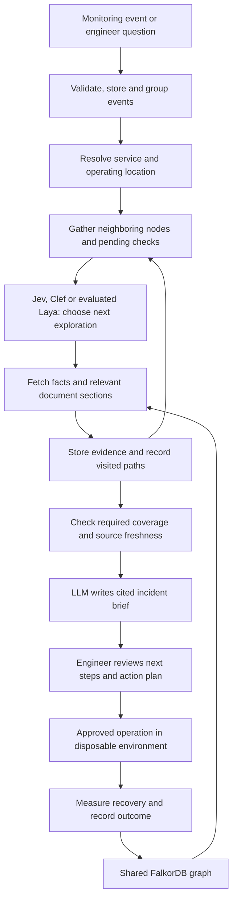

# SRE integration plan for the Company Brain

Status: planned, 2026-10-09. This is a coding plan and documentation integration, not an implemented agent or connected account. Requirements: [SRE event handling](../sre_event_handling.md). Data model: [SRE graph extension](sre_graph_schema.md). Reuse [contracts](contracts.md) and [existing phases](README.md).

## 1. Architecture decision

One Company Brain supports development questions and incident questions through the same entity identities, source adapters, permissions, decision-model interface, evidence store, traversal trace and answer LLM.

For incidents, use **model-guided graph exploration**. The decision model selects a next node or evidence request from application-provided choices. Application code fetches those choices, tracks several pending paths, enforces mandatory checks and records evidence. Known factual joins remain ordinary queries; there is no need to ask a model which commit a deployment record identifies.

Webhook acceptance and investigation are separate operations. Graph ingestion writes occur through source adapters. Investigation reads cannot change service state, close an incident or send a page. Action execution is a separately authorized operation, with a narrower interface than a general agent tool.

## 2. Graph access and MCP

Provide one `GraphReader` interface for exact lookup, permitted neighbors and approved read templates. Offer a direct FalkorDB adapter and a FalkorDB MCP adapter behind it. The [official MCP server](https://github.com/FalkorDB/FalkorDB-MCPServer) documents graph reads and writes, including read-only queries; that capability is not a reason to expose every tool to an incident model.

For the requested MCP path, pin the server version, use authenticated local transport, set/read-check supported read-only behavior and allowlist only the required graph/read operations. Validate request scope and parameters before the adapter call. Prevent graph creation/deletion and arbitrary write access from investigation. Test that malicious payloads cannot inject queries or access another company. Model outputs are IDs/action choices, never executable Cypher strings.

An MCP timeout returns partial investigation status; it does not trigger broader tool access. The direct adapter is a labeled fallback for availability/comparison, not a claim that MCP ran. Database schema/index operations remain operator-only.

## 3. Node exploration and stop conditions

For the POC, alerts identify an exact service instance. Interactive questions use the authorized `GET /service-instances` picker with labels such as `Payments / Demo / Region A`; selecting an instance submits a fresh query with existing scope fields. Validate all supplied IDs/environment/region together. An ambiguous or conflicting subject returns the typed 422 scope error in [contracts](contracts.md#poc-incident-scope-selection), without investigation conclusions. An accepted unresolved alert remains durably pending; an authorized explicit selection through the incident investigation endpoint is recorded before enrichment starts. Task/repository/branch continuation tokens remain unchanged.

Store `InvestigationState` with question/alert, operating scope, current node, pending candidate/check queue, visited node/edge IDs, retrieved evidence IDs, source snapshot, required-check status, token/call/time budget and stop reason.

Allow `EXPLORE_NODE`, `FETCH_EVIDENCE`, `ASK_FOR_HELP`, `STOP`. An option maps to an accessible actual neighbor or a supported evidence adapter. Candidate descriptions include relation direction, type, name, relevance summary and observation age. Model selection is validated against the exact current choice set.

Start with up to 10 choices per call, six navigation calls, 200 visited entities and eight relationship levels as configurable demo budgets. Related independent questions can be batched against the same state. A selected node may expose new choices requiring another request. Avoid repeatedly sending full documents; the evidence store retains their relevant sections for the final answer.

Mandatory checks: service/environment resolution, current and incident-time deployment coverage, ownership/current on-call, runtime dependencies within declared scope, customer evidence coverage and current runbook lookup. Initialize application-owned `InvestigationCheck` records before exploration. The model selects among eligible reads or optional context; it cannot remove a required check or set its outcome. Known joins execute in bounded templates. Record status, coverage, attempted time, evidence and sanitized failure for each check.

Use KNOWN for retrieved facts, MISSING only for an adequately complete authoritative lookup establishing absence, STALE for expired evidence, RESTRICTED for access denial, UNAVAILABLE for a failed/timed-out lookup, and NOT_CHECKED for unattempted work. Normal model STOP is accepted only when every required check has an attempted outcome; premature STOP selects the next required read deterministically while budget remains. Repeated STOP cannot create an unbounded model loop. On budget/deadline exhaustion, end with a partial stop reason and expose remaining NOT_CHECKED checks. A partial brief is useful; an action requires complete, current, permitted evidence for every action prerequisite. A recorded KNOWN status alone is insufficient. Optional PR discussion, similar incidents and design context remain model-prioritized.

When budget, access or a source fails, produce a partial brief with unresolved checks. Do not report full impact or an executable recovery plan from incomplete prerequisite data. Service-call cycles use visited tracking and can still be explored; they are not confused with an invalid task/action dependency ordering.

## 4. Shared-phase coding map

The earlier documents are plans, not completed code. Start with their common infrastructure rather than assuming it exists. The following describes the SRE deliverables in those same phases.

| Existing phase | Incident work to add | Completion evidence |
| --- | --- | --- |
| 0: foundation | Incident contracts, source scope and event/deployment fixtures | Payload examples and valid time/identity mappings |
| 1: graph | New labels/edges, versioned deployment/assignment records, read templates | Repeatable seed and incident-time queries |
| 2: ingestion | Event receiver, durable job record, duplicate handling, deployment/on-call manifests, observations | One repeated event; one incident; no duplicate proposed effects |
| 3: traversal | Neighbor reader, several pending paths, required-check coverage, customer exposure and action checks | Correct observed/possible outcomes and blocked incomplete plans |
| 4: models | Jev/Clef/Laya navigation choices, stopping/uncertainty, LLM-navigation comparison | Measured routing precision, missed evidence, cost and latency |
| 5: answers | Incident bundle, cited brief, recipient/action drafts and fallback | Real LLM explanation preserving facts/uncertainty |
| 6: demo | Incident page, timeline, evidence view and approved sandbox action | Replayed incident, reviewed plan and measured sandbox recovery |
| 7: production | Actual source integration, permissions, notification delivery and restricted production executor | Access/freshness/action checks plus operational readiness review |

## 5. Ordered coding work

Shared Phase 1 durable per-projection recovery and Phase 2 live Plane/Google Docs gates apply to this path. Every direct/MCP read declares STRUCTURAL/INCIDENT scope and captures a complete read set. Dirty required projections block conclusions; unrelated publications preserve equivalent inputs. Keep event receipts, lifecycle/action audits and jobs in retained storage. Accepted events follow [fixed bounded incident windows](graph_publication.md#durable-incident-batching), not per-alert structural rebuilds; acknowledgment does not wait for graph recovery. [Source adapters](source_adapters.md) retain live coverage and labeled exports.

### Step A: seed and shared graph

Create proposed files `fixtures/sre/`, `backend/app/contracts/incident.py`, `backend/app/graph/templates/sre/`, `scripts/seed_sre.py` and `tests/integration/test_incident_time_graph.py`. Seed the requirements example using real generated Git revisions or explicit synthetic artifact IDs; never invent a supposedly verified production SHA. Preserve existing task/PR identities and query semantics.

Gate: the graph finds the correct historical rollout, current on-call override, current runbook and two customer paths. Region B is not folded into region A. Replay does not overwrite earlier deployment facts. Phase 1 interruption/restart recovery preserves the retained incident inputs and blocks reads until a full coherent rebuild succeeds.

### Step B: event handling and evidence adapters

Create `backend/app/ingestion/{alerts,event_log,event_batches,incident_projection}.py`, `backend/app/incidents/{grouping,jobs,timeline}.py` and `backend/app/connectors/{monitoring,deployment,oncall,customer_usage}.py`. Persist deduplicated receipt/job before 202, then coalesce projection updates in fixed 30-second windows with caps and a minimum 15-second READY interval. Apply only incident-owned deltas with retained full recovery bundles; accepted arrivals during publication wait for the next batch. Rebuild timers/positions from durable state after restart. Start with synthetic/exports and verify real authentication/payload contracts before claiming a live receiver.

Gate: duplicates converge on one alert/episode without new projection work; unrelated alerts stay separate; fixed windows cannot be extended by a trickle; caps/backpressure preserve accepted events; restart before/after publication loses no receipt or duplicates a projection. Measure backlog age, read-blocked fraction and freshness. Incident publication/recovery preserves structural records and structural-only reads. Failed enrichment stays visible/retryable. A durable local transactional single-worker queue suffices; distributed failover remains Phase 7. Live Plane/Google Docs smoke gates still apply; operational sources may remain labeled synthetic/exported.

### Step C: exploration and conclusions

Create `backend/app/traversal/{neighbors,investigation}.py`, `backend/app/incidents/{changes,impact,responders,recovery_options}.py` and `backend/app/graph/mcp_reader.py`. Reuse the decision interface and extend it with a Clef adapter when accessible. Resolve known IDs first; ask the decision model for exploration ordering and ambiguity.

Gate: several dependency paths are retained; optional selection cannot drop required checks; a code deploy remains a possible explanation without confirming evidence; configuration-only failures are investigated; observed customer evidence is separate from possible exposure; runtime cycles terminate within limits; unauthorized results do not reach a model.

### Step D: brief and proposed action

Create `backend/app/context/incident_bundle.py`, `backend/app/answers/incident.py` and `backend/app/actions/{plans,validate}.py`. Use the existing evidence IDs and citations. Render targets, version IDs, current responder, impact states and action state from typed fields. The LLM explains; it cannot promote a hypothesis, approve a plan or invent a command.

Gate: real answer API output supports every factual claim with supplied evidence; injected source instructions, unavailable models and unknown citations trigger useful fallback. Plans bind exact service instance, environment, observed deployment state and target artifact; missing schema/config compatibility blocks execution. Message drafts remain drafts.

### Step E: sandbox and responder demonstration

Create `backend/app/actions/{sandbox,jobs,status}.py`, `frontend/src/components/{IncidentPage,IncidentTimeline,ImpactList,ActionReview}.tsx`, `scripts/replay_incident.py` and `tests/end_to_end/test_sre_incident.py`. The disposable sandbox adapter accepts only the vetted restoration. Record approval separately; execute returns 202 after durable claim/receipt/job commit, and the UI polls `GET /action-plans/{plan_id}` for operation and recovery progress. Target mutation and 30-second probes run in the worker.

Gate: approved operation changes the intended disposable target once; repeated requests do not repeat it; changed state/expired approval refuses execution; recovery checks show actual sandbox results; no production credentials or outbound messaging tools are used. Verify cancellation, partial failure and actual-state re-read before retries.

### POC sandbox recipe

Implement one `RESTORE_SANDBOX_ARTIFACT` adapter for a disposable local payments workload. Build two immutable artifact versions: one healthy and one with a controlled request failure. Retain their digests and actual served version identity. The fixture manifest supplies a versioned compatibility record for current/target artifact, configuration and schema. Unknown/incompatible combinations cannot produce a review-ready plan. A second scenario changes schema compatibility and must block the same proposed restoration.

Use the [canonical execution protocol](contracts.md#poc-sandbox-execution-protocol). Store exact plan version, approval actor/time, target state, expiry, compatibility record and unique operation ID in retained transactional local storage. The sandbox adapter is the only target writer; route reset through it as a separately controlled demo operation when no execution/reconciliation is active. The per-target gate serializes recheck and execution; no model-written scripts or mutable target substitutions are accepted.

After permission, scoped-evidence, target/compatibility and expiry checks, atomically persist APPROVED-to-RUNNING claim, target reservation, unique QUEUED receipt and durable job. Return 202 plus the plan-status Location; duplicates return the same operation. The worker rechecks current inputs and persists APPLYING before mutation, then persists known outcome/artifact before sampling. QUEUED jobs resume with the same ID; uncertain APPLYING jobs become UNKNOWN_OUTCOME and retain reservation until reconciliation. A matching digest alone cannot invent success; never automatically repeat an uncertain mutation. Pre-claim cancellation prevents changes; post-claim cancellation cannot imply undo.

After known successful restoration, the background worker sends one synthetic request per second for 30 seconds and persists samples/progress. All 30 and the expected artifact identity are required for PASSED. Failed/interrupted checks record FAILED/INCOMPLETE recovery while retaining the known operation outcome. Release the durable reservation after terminal known outcome/recovery recording; uncertain operations remain reserved. Authorized status polling reads retained records even during graph recovery, starts no execution and continues until operation/recovery settle. Neither result closes the incident.

Required cases: prompt 202 with persisted claim/job/receipt, authorized status/progress polling, failed durable enqueue with no acceptance/side effect, duplicate/concurrent execution, missing approval, expiry, moved target, incompatible schema, cancellation, queued-job restart, crash in APPLYING before/after mutation, receipt failure and failed/interrupted sampling after known success. Probes never hold an HTTP connection or graph gate. Duplicate requests reuse the job; status routes enforce current access. These remain future implementation gates.

## 6. Practical demo allocation

The incident-focused demo reuses the same phases as the development demo: foundation, graph, ingestion, traversal/checks, model evaluation, answers, UI/sandbox/rehearsal and recovery. It is an alternative demo allocation over those phases, not an additional workload. Re-estimate effort after the recovery/persistence and live-adapter compatibility checks rather than committing to hour figures in advance.

Delivering every development workflow and every incident workflow together is not promised. Keep shared schema/contract compatibility and retain development fixtures for regression when those workflows are implemented. If scope must shrink, cut additional live operational connectors, optional design-discussion retrieval and elaborate visuals. Preserve durable recovery, candidate-specific revision effects, live Plane/Google Docs task/document reads, evidence correctness and a real model-guided traversal-to-LLM example. Export fallback cannot pass the full live gate. If sandbox action remains unfinished, label the result as advisory and do not claim Track 01 action execution was demonstrated.

Track 01/03 alignment has been checked against the public event pages on 2026-10-09. The [FalkorDB resource plan](falkordb_resources_and_hackathon_plan.md) records current track guidance and submission requirements. It recommends a focused incident/recovery demonstration and maps the official SDK/tools to these same phases. Recheck any announced rule changes before submission.

## 7. Acceptance suite and evaluation

Seed at least 20 distinct incident scenarios covering the requirements list, with expected source scope, responder, deployment, possible/observed customer effects, plan eligibility and stop reason. Keep scenario variants in the same evaluation split to avoid teaching on the test case. Human review of briefs is necessary alongside contract tests.

Compare three navigators: direct graph/rules baseline, a general LLM selecting from the same allowed neighbors, and a decision model selecting from those neighbors. Keep source snapshots, permitted tools, mandatory checks, budgets, final answer model and evidence expectations constant. Compare cost per correctly grounded brief, missed paths, wrong selections, source reads, retries, answer-input size, latency and operator time. Report unavailable providers as unevaluated and synthetic cases as synthetic.

Record any failure that calls a hypothesis a confirmed cause, calls possible exposure an observed failure, chooses the wrong responder, sends a duplicate message or executes an unapproved/stale plan. None are acceptable in the controlled demo suite. Passing the suite is not proof of safe unattended production operation.

## 8. Live-release prerequisites

Select authoritative deployment/catalog/on-call/customer sources and approved actions. Add provider-specific authenticated receivers, reconciliation, access revocation, redacted telemetry, bounded retention, current-state checks and audit storage. Production notifications require verified recipients and organization policy. Production changes require scoped credentials, approvals, per-target locks, idempotency and recovery observations. Existing source monitoring/paging continues to work when the assistant is down.

Reliability follow-up tasks and reviewed incident history become ordinary Company Brain knowledge. Preserve correction history and source authority so an old model explanation does not become a trusted fact merely because it was stored.
