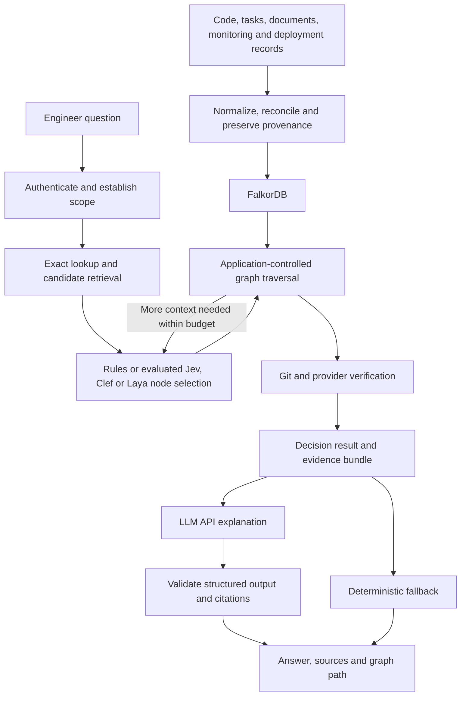

# Company Brain: architecture and implementation design

Status: proposed design; application implementation has not started. Revised 2026-10-09.

## Product intent

Create a Company Brain that connects epics, stories, tasks, repositories, branches, commits, PRs, code reviews, design documents and operational documents. An engineer asks a short question and receives context, a practical recommendation and the evidence behind it.

The first complete use case is: **Which branch should I branch from to implement the Public API when its backend dependency has not reached the stable branch?** The same graph should explain task blockers, find design/process documents, and summarize initiative progress.

The incident-handling extension is specified in [SRE event handling](sre_event_handling.md). It connects the same code/task/document entities to monitoring, actual deployments, service dependencies, current on-call assignments and customer observations. The [SRE integration plan](design/sre_integration_plan.md) supplies an SRE-focused coding/demo path while retaining the development use cases.

For the hackathon, lead the demonstration with the incident workflow and a recovery decision that changes when graph evidence changes. The [FalkorDB resource plan](design/falkordb_resources_and_hackathon_plan.md) evaluates the official Python client, MCP server, Browser/Canvas, native algorithms and GraphRAG SDK against that goal. Use source-owned operational facts for decisions and evaluate SDK document retrieval through an explicit compatibility gate. No SDK component is installed by these design documents.

## Evaluation of the original design

| Original assumption | Revised design |
| --- | --- |
| Typed decisions eliminate hallucinations | They constrain outputs, but can still choose incorrectly. Measure errors and support abstention. |
| Laya/Jev issue Cypher and traverse autonomously | Application code executes bounded query templates; a model chooses among allowed intents or retrieved candidates. |
| A low `noul` probability proves main lacks the implementation | Provider merge fields and Git verification establish availability. Model probabilities cannot override facts. |
| Linking a task to a branch proves its code exists there | Confirmed task-to-PR and task-to-delivery-revision links identify implementation; branch pointers can move. |
| Finding a TLS runbook means the task is unblocked | Instructions offer a resolution path. Task state stays as recorded by its source. |
| Retrieval is the final answer | Build an evidence bundle, then call an LLM API to explain it with citations. |
| An early prototype is production-ready | Deliver a reproducible single-tenant prototype; production has a separate phase. |

Explicit graph paths support relationship queries, but there is no universal five-hop failure threshold for vector retrieval. The goal is to reduce unsupported answers and expose their provenance, without promising zero hallucinations.

## Architecture

Recommended initial stack: Python 3.11+, FastAPI, Pydantic, FalkorDB Python client, Docker Compose, and React/TypeScript. These are defaults for a new implementation, not existing code. Pin tested versions in Phase 0 and use Docker Desktop/WSL2 where appropriate on Windows. The answer LLM and decision provider use independent adapters.

The development scope covers one organization, one project and one repository. Start with fixtures and structured exports, then require read-only live Plane, Google Docs and GitHub adapters for demo completion. Jira exports and Markdown remain supported and visibly labeled alternatives. The [source-adapter specification](design/source_adapters.md) defines identity, authentication, normalization, coverage and live smoke checks. The SRE-focused demo adds a small synthetic service/deployment/on-call/customer dataset; its scope and alternative demo path are defined in the SRE plan. Additional live operational sources and enterprise permissions follow after the demo.

Imports use the [Phase 1 durable protocol](design/phase_01_graph_and_fixtures.md#snapshot-consistency) with separate STRUCTURAL and INCIDENT ownership/state in one FalkorDB graph. Retain complete per-projection recovery bundles and persist DIRTY before mutation. Incident events are durably logged and coalesced into fixed 30-second windows, with bounded batches and a READY read interval; update incident-owned records without rebuilding the structural graph. Recovery blocks reads requiring the affected projection. Every answer validates its complete semantic read set, access and freshness; unrelated generation changes do not discard valid LLM output. See [graph publication](design/graph_publication.md).

The hackathon POC uses one application writer and completes initial scenario publication before investigation; subsequent event batches follow the configured cadence. Curated manifests are valid inputs; automated mapping maintenance remains future work. Shared contracts preserve request-local suggestions/audits, explicit incident scope, required checks, typed answer facts and independent source-access invalidation. Clarification selections survive unrelated imports and recompute current evidence. Approved sandbox execution returns 202 with a durable job receipt; the worker restores the target and measures recovery while the UI polls plan status. [Core decision index](design/README.md#poc-core-decisions).

## Canonical graph

See [graph schema](design/graph_schema.md) for properties, identity and provenance.

| Node | Main relationships |
| --- | --- |
| `Epic` | `HAS_TASK -> Task` |
| `Task` (story or task) | `HAS_TASK -> Task`, `DEPENDS_ON -> Task`, `IMPLEMENTED_IN -> Branch`, `IMPLEMENTED_BY -> PullRequest`, `DELIVERED_BY -> Commit` |
| `Repository` | `HAS_BRANCH -> Branch`; configured stable ref |
| `Branch` | `HEAD_AT -> Commit`, `HAS_PR -> PullRequest` |
| `PullRequest` | `TARGETS -> Branch`, `IN_REPOSITORY -> Repository` |
| `Review` | `REVIEWS -> PullRequest`, `REVIEWED_COMMIT -> Commit` |
| `Commit` | `PARENT -> Commit` where history is available |
| `RevisionEffect` | `EFFECT_AT -> Commit`, `AFFECTS_REVISION -> Commit`, reapplication `RESOLVES_REVERT -> RevisionEffect` |
| `Document:DesignDoc` | `SPECIFIES -> Task` |
| `Document:ProcessDoc` | `GOVERNS_PROCESS -> Task` |
| `CheckRun` (optional in the demo) | `CHECKS_COMMIT -> Commit` |

All nodes and relationships carry tenant identity, source references, observation times and snapshot identity. Relationships distinguish explicit/confirmed links from inferred candidates. Inferred links cannot justify a branch command. Store document content/version and individual reviews, not just titles and an aggregate review string.

When task IDs are missing from branch names and commit messages, use the [Clef task-branch fallback](design/task_branch_association.md). Intersect assignment history with in-progress periods, map the assignee to Git author identities, and retrieve their branch activity in that window. Clef compares task purpose with messages, changed files and competing simultaneous tasks, returning likely, multiple, ambiguous or no-match associations. Preserve period/author/commit evidence and model scores as inferred candidate links; temporal correlation is not confirmed implementation or delivery. Explicit provider/manifest mappings take precedence.

The [SRE graph extension](design/sre_graph_schema.md) adds incident, deployment, artifact, service-instance, ownership, on-call, customer-feature, observation and action-plan records. It reuses existing entities and preserves operating-location/time information. A task assignee is not assumed to be a code author or current responder; a deployed revision is not assumed to be the cause of a failure.

## Where decision models fit

Use model-guided exploration to select useful neighboring nodes or evidence requests from application-provided choices. Maintain several pending paths and record the retrieved context and path before calling the answer LLM. Evaluate Jev, Clef and Laya against rules and general-LLM navigation baselines. Known factual joins, required dependency coverage, source identity and state verification remain in application code. The [model decision record](design/decision_models.md) documents provider capabilities, primary sources, limits and evaluation; no winner or inherent cost saving is assumed.

| Decision | Implementation |
| --- | --- |
| Resolve Task-404 in a known project | Exact indexed lookup |
| Interpret a paraphrased question | `choice` among supported intents plus `OTHER` |
| Resolve ambiguous task titles | Retrieve scoped candidates, then select or ask for clarification |
| Choose related document context | Structural/type/version filters, then semantic selection if useful |
| Does review text describe a deployment blocker? | Optional `noul`, with cited input and uncertainty handling |
| Rank narrative urgency | Optional `score` with a defined rubric; explicit ticket priority takes precedence |
| Is a PR merged? Does a branch contain a required revision? | Source fields and Git checks |
| Which ID-free branch likely implements an assigned in-progress task? | Work-period/author retrieval, then Clef association judgment with ambiguity and no-match options |
| Which incident node or evidence should be explored next? | Model `choice` over scoped neighbors and pending checks; preserve several paths |
| Who is on-call now? What was deployed? Are customers failing? | Current assignment, deployment and measurement records; model choices do not establish these facts |

Retrieve known factual paths in bounded graph operations. Use a decision call when choosing the next exploration is useful, rather than mechanically calling a model for every edge. Retain full relevant facts/document sections in the evidence store, while passing compact summaries to navigation calls. Record templates, parameters, visited nodes/edges, candidate selection, freshness, required-check coverage and stop reason. A chosen path does not establish that all relevant paths were checked.

## Branch recommendation policy

Availability, review readiness and deployment readiness are separate fields. Available code with requested changes may be usable for dependent development under policy, with a visible warning. Availability must never imply approval or deployment readiness.

1. Resolve the target task, repository and configured stable ref; `main` is only an example.
2. Traverse all confirmed prerequisites, including transitive ones. Report cycles and incomplete or inaccessible evidence.
3. Identify confirmed required delivery revisions for each prerequisite. Branch names and PR titles alone are insufficient.
4. Refresh candidate heads and relevant PR/review state; evaluate stable first, then eligible feature branches in the same repository.
5. Verify coverage for every required revision and its confirmed revision effects against each candidate's exact head. Conventional merges support ancestry checks; squash/rebase delivery requires a confirmed integration mapping. Missing mappings/history or ambiguous restoration produce `UNKNOWN`.
6. Recommend stable if coverage is verified. Otherwise select a policy-allowed live feature branch covering **all** prerequisites. If none exists, return an integration proposal without a single-base command.
7. Attach review warnings, candidate-specific revert/reapplication evidence, verification time, graph generation and exact candidate head SHA. Commands come from deterministic templates.

Ancestry proves historical inclusion, not that later code preserves every behavior. A confirmed complete revert blocks a delivery only on candidate histories containing that revert; an unchanged feature can remain usable while stable is reverted. A confirmed complete reapplication restores coverage only when it is included, descends from the revert and explicitly resolves it. Every applicable revert needs resolution; integration alternatives cannot bypass the same-group veto. Disclose unresolved semantic preservation. The MVP uses curated complete delivery/effect mappings; incomplete live data must produce a limited answer. [Phase 3](design/phase_03_traversal_and_branch_decisions.md) defines the algorithm and edge cases. The MVP proposes commands; controlled branch creation is later work.

## Worked workflows

**Payments.** Backend Service, UI Layer and Public API belong to Epic-Payments. UI and API depend on Backend Service. The backend has a confirmed delivery revision on `feature/backend-service`; its PR is open with requested changes. Verification shows stable lacks the revision and the feature branch contains it. Recommend branching from that verified head for dependent development, cite the task/design/PR/review, and explain that integration still requires backend changes and review. Show `Epic -> API Task -> DEPENDS_ON -> Backend Task -> DELIVERED_BY -> Commit`, together with the implementation branch and PR target. Independent dependencies on unrelated branches require an integration proposal.

**TLS.** Resolve Task-404, follow incoming `GOVERNS_PROCESS` edges, retrieve the current accessible runbook content, and explain only supported steps with its source link. Keep the task's observed state unchanged. If four of five eligible leaf tasks are completed, display `4/5 = 80%` with counts and observation time. Report incomplete status coverage explicitly.

## Coding phases

Start at the [implementation index](design/README.md). Each document defines coding tasks, proposed files, validation and a completion gate.

| Phase | Deliverable |
| --- | --- |
| [0: Foundation](design/phase_00_foundation.md) | Runtime, contracts and scenario fixtures |
| [1: Graph](design/phase_01_graph_and_fixtures.md) | Schema, durable import/recovery and query templates |
| [2: Ingestion](design/phase_02_ingestion_and_sync.md) | Plane/Google Docs/GitHub reads, exports and explicit links |
| [3: Traversal](design/phase_03_traversal_and_branch_decisions.md) | Verified branch and blocker decisions |
| [4: Decision models](design/phase_04_decision_model_integration.md) | Adapters, evaluation and routing gate |
| [5: Answers](design/phase_05_context_and_llm_answers.md) | Evidence bundle, real LLM API call and fallback |
| [6: Demo](design/phase_06_ui_evaluation_and_demo.md) | Query UI, graph explanation and regression checks |
| [7: Production](design/phase_07_production_and_actions.md) | Permissions, reliable sync, actions and broader context |

Phase completion is defined by each phase's completion gate, not by elapsed time. Re-estimate effort after the actual recovery/persistence and live-adapter compatibility checks rather than committing to hour figures in advance. Export ingestion and rules routing remain labeled fallbacks if integrations/model setup cannot be completed, but export-only results do not complete the live Plane/Google Docs gate. At least one real LLM API call is required to demonstrate the requested retrieval-to-explanation workflow; fallback-only operation is a partial deliverable.

## Success criteria

- Payments returns the verified backend base with review warnings and source citations; complete stable delivery selects stable instead.
- Independent dependency branches, stale data, missing mappings, cycles and inaccessible prerequisites withhold a single-base command and explain the limitation.
- Task context includes available design/process documents, implementation and individual reviews with source versions.
- LLM prose cannot change branch/revision selections, task states, progress, commands or source links.
- The UI exposes the actual traversal and verification evidence and distinguishes fixtures from live results.
- Interrupted imports remain blocked across application/database restart until a validated full rebuild; no mixed-snapshot answer or command appears.
- Incident ingestion uses durable bounded windows and affects only its projection; structural-only reads remain available during incident recovery.
- Unrelated imports preserve equivalent answer inputs; changed relationships, counts, absence results, access or heads invalidate affected answers without silently reusing prose.
- Clarification tokens survive unrelated imports while revalidating selected candidates; sandbox execution returns a durable 202 receipt and exposes operation/recovery progress through polling.
- Stable merge/revert does not exclude an unchanged valid feature; complete confirmed reapplication restores only applicable candidate histories.
- Live Plane tasks and Google Docs content produce actual source-backed context/citations; unavailable adapters keep the full demo gate incomplete.
- ID-free task/branch discovery uses assignment/in-progress history and author/content evidence; Clef suggestions and ambiguities remain visible without becoming confirmed delivery coverage.
- Model accuracy, abstention, latency and cost are measured separately from graph/branch correctness.

Incident requirements add correct historical deployments/current responders, observed versus possible customer effects, cited possible explanations, version-bound recovery proposals and approved sandbox actions. Runtime service-call cycles permit bounded investigation; they are distinct from invalid task/action execution ordering. See the SRE requirements and integration plan for acceptance cases. No production messages or changes are performed by this document update.

The [shared contracts](design/contracts.md) and [schema](design/graph_schema.md) are canonical across phases. The [original draft](design/original_requirement_doc.md) is preserved.
